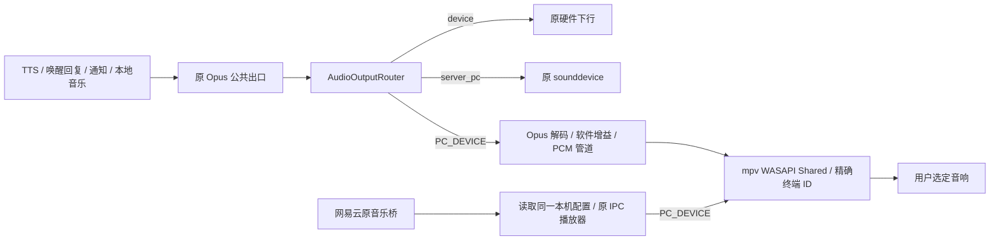

# 指定 Windows 音频设备输出（PC_DEVICE）

2026-10-22：已实现并在当前 Windows 桌面环境测试。当前选择 **耳机 (X1 Stereo)**，小智音量 35%。设备名称只用于首次发现；程序持久化 Windows 输出终端 ID，没有硬编码 X1。

后续听感复核纠正了最初的判断：X1 Hands-Free AG Audio 虽然设备 active、播放器返回成功，但用户实际只能听到电流声。直接 WAV 和原 sounddevice 播放也有相同问题；改用同一音响的 Stereo 后，用户确认中文语音清楚正常。网易云原先因软件音量曲线被过度压低，修正后用户也确认音乐清楚正常。游戏耳机并行播放、物理断连/重连、注销、长时间播放仍需人工验收，不能视为已经通过。

## 使用

1. 在 Windows 设置中配对并连接音响。无需在 Windows 中更改默认输出设备。
2. 运行 `music.cmd --open`，进入本机管理页的“小智音频输出”。
3. 选择“指定 PC 音频设备”，在输出设备列表中选择已连接音响。
4. 点击“中文语音测试”，确认听懂“这是小智的中文语音测试”，再点击“保存音频输出”。测试不保存选择，只临时压低音乐并恢复，不会清空队列；更换设备会暂停并保留队列，同一设备重复保存或调音量不清空队列。
5. 正常唤醒小智或点歌。无需为音乐、TTS 分别选择设备。硬件麦克风、唤醒、BOOT 输入保持原链路。

启动器音频菜单新增选项 3，可直接枚举并选择可用输出终端。保存过设备后，启动时按回车沿用；也可运行 `start-all.cmd -AudioOutput PC_DEVICE`。首次更新本次代码需重启 Python 语音服务和音乐服务，此后通过页面保存音频配置会自动生效。

管理页授权入口为 `music.cmd --open`。本次同时修复授权仅保存在单个标签页、打开新标签页反复“本机管理页未授权”的问题：已授权请求建立同源 `HttpOnly; SameSite=Strict` 浏览器会话 Cookie（不同于命令行桥 token），同一浏览器会话刷新/新标签页及音乐服务重启可以复用。无 Cookie/无 token 的请求仍拒绝，Host/Origin/JSON 内容类型限制继续生效。新浏览器、清理 Cookie 或结束浏览器会话后仍需从授权入口打开；网易云账号登录与此独立，无需因此重新扫码。

CLI（在项目根目录运行）：

```powershell
.\audio-output.cmd --list-devices
# 名称必须唯一匹配一个可用输出；仅发现时使用名称，保存的是终端 ID。
.\audio-output.cmd --mode PC_DEVICE --select-name "X1 Stereo" --volume 0.35 --test
.\audio-output.cmd --test
.\audio-output.cmd --mode server_pc
.\audio-output.cmd --mode device
```

原 `server_pc --device <sounddevice名称或编号>` 的指定方式继续保留。严格禁止默认回退的场景应使用 PC_DEVICE。运行中的网易云音乐建议通过管理页保存输出方式，以便更换终端前暂停旧播放器；CLI 和直接编辑配置由监控下一次检查发现变化。

## 实际代码分析与最小改造范围

历史 `codex://threads/01a13a76-3675-73c2-8f4a-f07aec0def53` 的本地 JSONL 记录及摘要可读取；历史内容用于定位项目，以下结论以当前源码和运行结果为准。工作目录原有未提交修改予以保留。

| 检查项 | 当前源码事实 / 本次处理 |
| --- | --- |
| 服务端 | Python 3.10、asyncio、WebSocket；Java Spring Boot 管理 API；Vue 2 智控台；Node 本机音乐桥 |
| 启动 / 平台 | 当前 Windows 10、交互用户会话，由 `start-all.ps1` / `scripts/start_local.py` 启动后台进程；不是 WSL/Docker 音频播放，也不是 Session 0 服务 |
| 原音频模式 | `audio_output.mode: device / server_pc`，本机配置优先，智控台不能覆盖本机声卡选择 |
| TTS / 服务端提示音 | `sendAudioHandle.sendAudio` 已是公共音频出口；唤醒回复、停止提示音、异常/绑定回复也经过该出口 |
| 本地文件音乐 | `play_music.py` → TTS DTO 队列 → 公共音频出口；MP3/WAV 等解码后转 Opus，沿用现有单声道链路 |
| 网易云音乐 | `services/music-bridge/music.js` → 独立 mpv / 命名管道 IPC；此前跟随 PC 默认输出，本次增加精确设备绑定 |
| 原 PC 播放器 | sounddevice 0.5.3 / PortAudio，可用名称或临时编号，不能直接把编号当持久 Windows 终端 ID |
| 硬件输出 | 下行 Opus 二进制经 WebSocket/MQTT 网关到硬件解码；PC 模式保留文字、TTS 状态消息，截获下行音频 |
| 优先级 | 网易云由唤醒/BOOT 暂停，需明确继续；TTS start/stop 对网易云执行软件 duck/unduck。本地音乐沿用原 TTS 队列与中断策略 |
| 不在服务端的数据 | 固件自行产生的开机、配网提示及独立硬件声音没有上行音频源，不能被服务端重定向；本次未改固件 |

没有替换 TTS、ASR、硬件协议或音乐业务。新增路由配置层，保留旧 sounddevice 后端；PC_DEVICE 复用已经安装的 mpv WASAPI 后端，使用 Python 标准库 ctypes 读取 Core Audio 设备，不增加音频驱动或大型依赖。

## 最终数据流



两条 PC_DEVICE 播放链路绑定同一终端；不同音频使用同一选定设备，保留多个播放器会话以沿用已有音乐和 TTS 协调机制。Python 仍以每连接播放锁限制并发回答；网易云独立播放器允许在同一设备混音。

Python 将 Opus 解码、重采样到 24 kHz/16 bit/mono PCM，经有界队列和带节奏的管道送入 mpv。正常结束关闭管道并等待尾音；中断终止该专属进程。音乐由原 mpv 直接解码 URL/文件。

所有显式播放均使用 `--ao=wasapi`、`--audio-device=wasapi/<完整终端ID>`、`--audio-exclusive=no`、`--audio-fallback-to-null=no`。不提供默认音频驱动候选，不传 `auto`。不打开 capture 终端、不调用默认设备设置或系统主音量设置 API。WASAPI 使用普通播放流，没有创建通信录音流或改变 Windows 通信设置。[mpv 文档](https://mpv.io/manual/stable/)

## 持久化配置与音量

保存位置：`main/xiaozhi-server/data/.config.yaml`。此文件含其他本机密钥，不要分享整个文件。

```yaml
audio_output:
  mode: PC_DEVICE          # device / server_pc / PC_DEVICE
  pc:
    device: null           # 仅原 server_pc 使用，保持兼容
    device_id: "{0.0.0.00000000}.{Windows实际分配的GUID}"
    volume: 0.35           # 小智软件音量，0~1
```

设备 ID 由页面或 CLI 自动填入，上面的 ID 是格式示意。音频配置约 250 ms 内被 Python 路由重新读取；音乐桥每秒检查一次（设备变化事件另行通知）。管理 API 刷新保留本机配置路径。配置写入沿用原 YAML 保留注释和原子替换机制，其他业务配置不变。

TTS、本地音乐、提示音在 PCM 层乘小智音量。网易云实际线性增益为“小智音量 × 音乐音量 × 临时音乐压低系数”。mpv 的 volume 百分比内部会取三次方，不能把相乘后的百分比直接传入，否则会过度衰减：小智 35%、音乐 40% 的目标增益是 0.14，对应 mpv volume 约 51.92，而不是 14。当前代码转换为 `100 × cbrt(目标线性增益)`，使其与语音 PCM 增益一致。[mpv 音量实现](https://github.com/mpv-player/mpv/blob/master/player/audio.c)

页面上方“小智音量”调节所有小智音频，下方“音乐音量”仅调节音乐。两处滑块均在松开后立即生效并保存；上方使用独立的音量更新接口，不修改设备选择、不停止音乐。刷新页面后使用新版滑块行为。这些都是小智专属软件增益，不写系统主音量、终端主音量或游戏音量。

PC_DEVICE 下说“把音量调到 20%”，现有设备 MCP 的音量工具会由服务端截获，更新小智软件增益，不发送给开发板喇叭；读取设备状态时同样报告当前软件音量，方便“再调大一点”等指令。原 `device` / `server_pc` 的硬件音量工具行为保持兼容。音乐原音量控件保留为音乐相对音量。

### 唤醒、音量与队列恢复

网页点歌与语音点歌共用同一音乐桥队列，均支持“唤醒 → 调音量 → 继续放歌”。此前 22:02:40 为加载音量修复重启音乐服务，旧实现仅存内存，因此随后恢复指令收到“当前没有音乐队列”；与是否通过小智点歌无关。

当前队列、曲目索引和最近播放秒数保存在 `.runtime/music/queue.json`，每 5 秒检查更新，暂停等状态变化立即保存。文件只保存歌曲基本信息和播放位置，不保存媒体 URL、Cookie 或 provider 密钥。明确停止、退出账号或更换音乐来源会清除队列快照；唤醒暂停、音量变化、重复选择同一设备不会清除。

服务重启后恢复为暂停状态，不自动发声。明确说“继续播放音乐”后重新获取当前曲目的有效地址并 seek 到最近保存位置；位置可能有数秒偏差，网络/音源不可寻址等错误会明确报告。空闲播放器的创建不再被视为已经加载曲目，恢复队列后先唤醒、再调音量仍会实际重新加载歌曲。设备更换或意外退出也使用保留的队列与位置，仍不会改绑默认设备。

真实接口复现记录 `.runtime/music/queue-regression-result.json`：网页建立的 375 首队列经音乐服务重启恢复为暂停状态，唤醒暂停、调整软件音量后，明确恢复仍为同一曲目、相同队列数，从约第 4 秒继续。

## 设备发现、断开与恢复

- `IMMDeviceEnumerator.EnumAudioEndpoints(eRender, DEVICE_STATEMASK_ALL)` 只枚举输出；返回 ID、名称、active/disabled/not_present/unplugged 状态、选中标记。已配对但没有 active 输出终端不能通过播放校验。
- 保存 `IMMDevice.GetId` 完整终端 ID。Windows 终端 ID 可跨重启保持；设备驱动重建/重新配对等可能产生新 ID。使用 ID 精确匹配，同名设备展示 ID 尾部帮助区分；不以名称猜测重连目标。[Microsoft 终端 ID 说明](https://learn.microsoft.com/en-us/windows/win32/coreaudio/endpoint-id-strings)
- 当前实现使用广泛支持的终端 ID，不依赖较新 Windows 的 StableId 属性做自动迁移。旧 ID 消失时要求明确重新选择，即使出现同名设备也不会自动改绑。
- mpv 原生 `IMMNotificationClient` 监控设备变化并保持指定 ID。Python 另有 250 ms 可用性监控，设备不可用即终止绑定进程；音乐桥同时观察设备列表事件并每秒核对可用性。播放失败明确记录错误，无默认设备后备路径。[mpv 设备变更实现](https://github.com/mpv-player/mpv/blob/master/audio/out/ao_wasapi_changenotify.c)
- 断开时丢弃本轮 TTS 队列，防止过时回复在重连后突然响起；新一轮可以在同一 ID 恢复后重新打开。音乐保留队列与最近位置，失联后停止输出，原 ID 恢复后说“继续播放音乐”会重新加载该曲目并尝试恢复位置，也可重新点歌；不自动播放旧内容，位置恢复允许数秒误差。
- 选择已断开/不存在设备会报错且不保存新选择。已保存设备在启动时离线允许服务启动，但播放拒绝；管理页显示不可用。重连后无须更改 ID，ID 变化时重新选择并保存。
- 蓝牙配对和连接由 Windows 负责。应用不会打开蓝牙麦克风。当前 X1 免提终端实测只有电流声，Stereo 已确认语音/音乐正常；免提噪声的具体驱动/蓝牙协商原因尚未确认。不同终端需以听感复核，不能仅凭 active 或主音量未变认定功能通过。

## 运行环境

当前环境使用 Windows 交互用户的 Python 和 Node 进程，直接访问 Windows 音响。开机启动应选择“用户登录时运行 / 仅当用户登录时运行”，使用同一用户；网易云凭据原有 DPAPI 也依赖该用户。

Session 0 Windows Service、WSL、Docker 和远程 Linux 服务不能通过本实现直接输出到交互用户的 Windows 音响。设备枚举会明确报错，不能通过改默认设备绕过。当前部署无需额外 Agent；若后续把主服务迁入这些环境，应把本播放端放在登录用户的 Windows 进程，并增加经过鉴权的音频流转发接口。本次没有交付跨主机音频 Agent，现有音乐桥也不是该 Agent。

注销后当前流可能失效，监控按失联处理。再次登录需启动项目进程后重建播放；不承诺跨注销保留播放位置。

## 自动测试及实机证据

在项目根目录：

```powershell
.\main\xiaozhi-server\.venv\Scripts\python.exe -B main/xiaozhi-server/tests/test_pc_audio_output.py -q
.\main\xiaozhi-server\.venv\Scripts\python.exe -X utf8 -m unittest scripts.tests.test_pc_voice_volume scripts.tests.test_pc_device_audio scripts.tests.test_start_local scripts.tests.test_music_page -q
.\main\xiaozhi-server\.venv\Scripts\python.exe -B main/xiaozhi-server/tests/test_music_service.py -q
node --test services/music-bridge/audio-test.test.js services/music-bridge/browser-auth.test.js services/music-bridge/audio-route.test.js services/music-bridge/music.test.js services/music-bridge/app.test.js
# 会真实发声，使用当前保存的设备，不修改系统音频设置
.\main\xiaozhi-server\.venv\Scripts\python.exe -X utf8 scripts/audio_device_smoke.py --run
# 需先正常点歌；同时检查网易云 TTS 协调、暂停/继续/停止，完成后停止歌曲
.\main\xiaozhi-server\.venv\Scripts\python.exe -X utf8 scripts/audio_device_smoke.py --run --with-music
```

实机脚本需要本机 SAPI COM 权限、原 FFmpeg/Opus、项目 mpv。受限沙箱内 SAPI 失败，在当前交互用户环境运行成功。无额外驱动安装。

自动化覆盖显式 ID 校验、拒绝输入终端 ID、设备缺失/同名不误绑、断连监控杀死绑定播放器、不启动默认播放器、软件增益、配置保存与失败不写入、热读、测试不保存、界面状态与编辑保护、启动菜单，以及原音频路由/打断/音乐功能回归。物理拔断/断电不由这些模拟测试替代。

最近自动测试结果：Python 原公共音频链路 20 项、Python 配置/启动/管理页/语音音量 51 项、Python 音乐服务 8 项、Node 音乐/设备/页面/会话授权 44 项，合计 **123 项通过**。覆盖中文测试、合成失败不回退嘟声、测试不清空音乐、mpv 线性增益转换、滑块实时保存、唤醒后恢复原队列、重启恢复位置、语音软件音量及搜索结果精确选曲。另有真实 HTTP 验证：首次授权 200、仅 Cookie 请求音乐及音频设置 200、无授权 401、跨站 Origin 403。

历史 `.runtime/audio-device-test/latest.json` 仅证明程序执行和系统快照检查完成；其免提终端结果已被用户“只有电流声”的听感复核否定，不能用作可听验收通过。当前 Stereo 中文确认与系统快照保存在 `stereo-confirmation.json`，音乐线性增益与系统快照保存在 `music-gain-confirmation.json`（同一目录）。默认设备及对应主音量在测试前后保持一致。最终实际听感以本节开头记录的用户确认为准。

### 尚需人工验收

| 场景 | 步骤 / 验收条件 |
| --- | --- |
| 游戏耳机与 X1 并行 | 用户按原习惯使用耳机运行游戏/视频，再唤醒小智和点歌。语音、音乐、通知仅来自 X1，耳机游戏声不断、不降低、不切换设备 |
| Windows Audio Ducking | 用持续、易比较的游戏/视频音轨，反复触发 TTS、提示音，确认实际响度不变；不要仅看系统主音量数字。代码不修改用户的 Windows“通信”策略 |
| 独立音量 | 在页面从 35% 调到 10%/60%，保存并播放；仅小智变化，Windows/游戏音量保持原值，再按偏好恢复 |
| 物理断连 | 正在播放时关闭 X1/断开蓝牙；小智停止且默认耳机无泄漏。页面刷新显示不可用，重连后同一 ID 可重新点歌/继续 |
| 错误设备 / 同名 | 选择不可用终端拒绝保存；不存在的旧 ID 保持未连接，不自动选取同名新设备 |
| 重启持久化 | 重启语音和音乐服务，确认仍为 PC_DEVICE / 原 ID；离线启动不泄漏，连接后恢复新播放 |
| 原模式回归 | 切回 server_pc / device，分别确认原 PC 音频、硬件模块声音及麦克风/BOOT 正常；再切回 PC_DEVICE |
| 稳定性 / 注销 | 连续播放 30~60 分钟，反复语音、暂停、停止；注销/重新登录后重启，确认错误可见且没有错误回退 |
| 实际硬件对话 | 通过实际开发板说话，检查原配置的 TTS 提供商、唤醒/中断、回声与本地音乐队列；独立脚本不是整条麦克风/LLM 对话验收 |
| 配置页视觉 | 管理页已打开；当前自动化环境未连接可控浏览器，页面视觉布局需要实际浏览器检查，API 和页面交互逻辑已有自动测试 |

## 本次文件清单

- `core/utils/windowsAudio.py`（位于 `main/xiaozhi-server/`）：只读 Core Audio 枚举、终端校验、系统音频快照。
- `core/utils/specifiedAudioOutput.py`：复用 mpv 的指定终端 PCM 输出与设备监控。
- `core/utils/audioOutputRouter.py`：统一路由、热读音频配置、清理旧播放出口。
- `core/utils/pcAudioOutput.py`：保留旧后端，增加 PC_DEVICE、动态软件增益及同设备路由。
- `core/handle/sendAudioHandle.py`、`config/config_loader.py`、`config.yaml`：接入公共出口、本机配置刷新与新配置说明。
- `core/providers/tools/device_mcp/mcp_executor.py`、`scripts/tests/test_pc_voice_volume.py`：PC_DEVICE 语音音量和读取音量状态接入软件增益。
- `scripts/audio_output.py`、`scripts/start_local.py`、`start-all.ps1`：CLI、设备选择、启动菜单与持久化；保留这些文件原有的其他修改。
- `services/music-bridge/audio-route.js`、`player.js`、`server.js`、`music.js`：读取同一音频配置、精确 mpv 绑定、音乐断连保护、重建播放器恢复曲目与配置 API。
- `services/music-bridge/index.html`、`app.js`：在原本机管理页增加输出设置、中文测试与即时音量调节。
- `services/music-bridge/audio-test.js`、`audio-test.test.js`：测试期间保留音乐队列并临时软件压低/恢复。
- `services/music-bridge/browser-auth.js`、`browser-auth.test.js`：跨标签页会话授权与回归测试。
- `main/xiaozhi-server/tests/test_pc_audio_output.py`、`scripts/tests/test_pc_device_audio.py`、`scripts/tests/test_start_local.py`、`services/music-bridge/audio-route.test.js`、`app.test.js`、`music.test.js`：安全与兼容性测试。
- `scripts/audio_device_smoke.py`、`scripts/audio_device_music_smoke.js`：可复现真实播放验证。
- 本文、`docs/pc-audio-output.md`：交付及使用说明。

本机配置文件和 `.runtime/` 下的测试结果不纳入源码提交。未创建提交；工作区原有无关修改保持原状。
